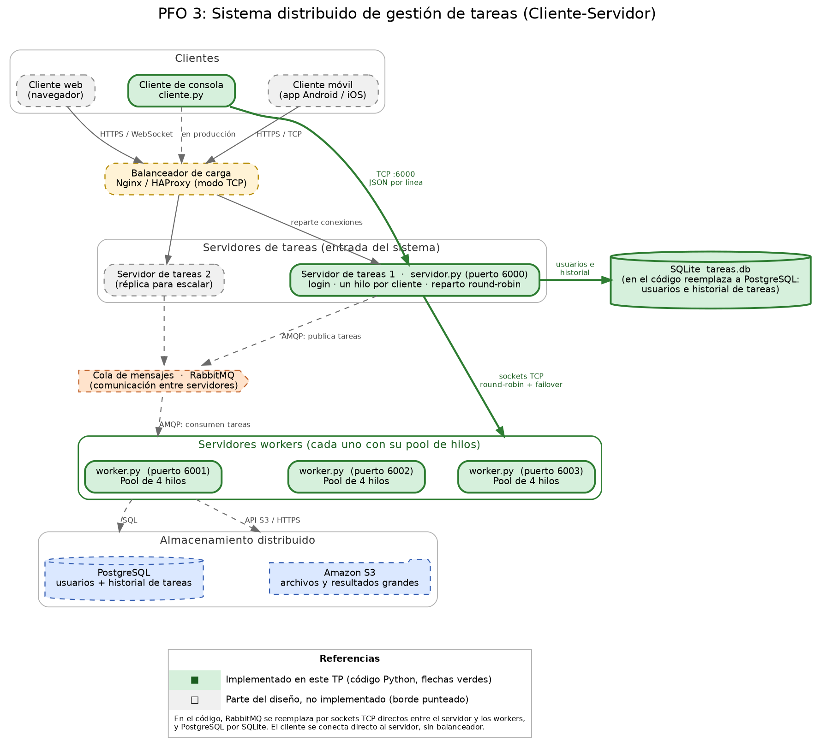

# PFO 3: Rediseño como Sistema Distribuido (Cliente-Servidor)

Programación sobre Redes - 1C 2026

Evolución del sistema de gestión de tareas de la **PFO 2**: pasa de una API
Flask monolítica a una **arquitectura distribuida con sockets**, donde un
servidor recibe las tareas de los clientes y las reparte entre varios workers,
cada uno con su propio pool de hilos.

## Diagrama del sistema



> Archivos del diagrama: [`docs/diagrama.png`](docs/diagrama.png),
> [`docs/diagrama.svg`](docs/diagrama.svg) y su fuente
> [`docs/diagrama.dot`](docs/diagrama.dot) (Graphviz).

### Componentes del diseño

| Componente | Rol | En este TP |
|---|---|---|
| Clientes (móvil, web, consola) | Envían tareas y reciben resultados | Implementado el **cliente de consola** (`cliente.py`) |
| Balanceador de carga (Nginx / HAProxy) | Reparte las conexiones entre servidores de tareas | Solo diseño |
| Servidores de tareas | Autentican, reciben las tareas y las distribuyen | Implementado (`servidor.py`) |
| Cola de mensajes (RabbitMQ) | Comunicación entre servidores | Reemplazada por **sockets TCP directos** |
| Servidores workers con pool de hilos | Ejecutan las tareas en paralelo | Implementado (`worker.py`) |
| PostgreSQL | Usuarios e historial de tareas | Reemplazado por **SQLite** |
| S3 | Archivos y resultados grandes | Solo diseño |

El borde verde del diagrama marca lo que está implementado en el código, y el
punteado lo que forma parte únicamente del diseño.

## Qué se reutiliza de la PFO 2

- La **tabla `usuarios`** y el **hasheo de contraseñas** con `werkzeug.security`
  (nunca se guardan en texto plano).
- Las **consultas parametrizadas** de SQLite (evitan inyección SQL).
- El flujo de **registro e inicio de sesión**, ahora sobre sockets en lugar de
  endpoints HTTP.
- El mismo archivo de base de datos `tareas.db`: un usuario creado con el
  servidor de la PFO 2 puede iniciar sesión en este sistema.

## Archivos

| Archivo | Descripción |
|---|---|
| `servidor.py` | Servidor de tareas: recibe clientes por socket, autentica y distribuye a los workers |
| `worker.py` | Worker: ejecuta las tareas con un pool de hilos |
| `iniciar_workers.py` | Lanza todos los workers juntos en una sola terminal |
| `cliente.py` | Cliente de consola: envía tareas y muestra los resultados |
| `comun.py` | Configuración, protocolo de mensajes y acceso a la base de datos |
| `docs/` | Diagrama del sistema (PNG, SVG y fuente `.dot`) |
| `requirements.txt` | Dependencias |

## Cómo funciona

1. El **cliente** se conecta al servidor por TCP (puerto 6000), se registra o
   inicia sesión y envía tareas.
2. El **servidor** atiende a cada cliente en un hilo propio, de modo que
   atiende a varios a la vez.
3. Por cada tarea, el servidor elige un **worker en round-robin** (6001 → 6002
   → 6003 → 6001 ...) y le envía la tarea por un socket TCP.
4. El **worker** recibe la conexión en su hilo principal y la delega a un hilo
   libre de su **pool** (4 por defecto). Si todos están ocupados, la tarea
   espera en la cola interna del pool.
5. El worker devuelve el resultado y el servidor lo guarda en el historial y se
   lo responde al cliente, indicando qué worker e hilo lo procesaron.

**Tolerancia a fallas:** si un worker no responde, el servidor prueba con el
siguiente. Solo si ninguno está disponible, informa el error al cliente.

### Tareas disponibles

| Tarea | Datos | Resultado |
|---|---|---|
| `factorial` | entero 0 a 1000 | Factorial de n |
| `fibonacci` | entero 0 a 5000 | Número de Fibonacci en la posición n |
| `primos` | entero 2 a 5.000.000 | Cantidad de primos hasta n |
| `invertir` | texto | Texto al revés |
| `mayusculas` | texto | Texto en mayúsculas |
| `dormir` | segundos 0 a 10 | Simula un trabajo largo (sirve para ver el paralelismo) |

### Protocolo

Mensajes **JSON, uno por línea**, sobre TCP.

```text
Cliente -> Servidor                                       Servidor -> Cliente
{"accion":"registro","usuario":"ana","contraseña":"1"}    {"ok":true,"mensaje":"Usuario 'ana' registrado ..."}
{"accion":"login","usuario":"ana","contraseña":"1"}       {"ok":true,"mensaje":"Bienvenido, ana. Login exitoso"}
{"accion":"tarea","tipo":"factorial","datos":20}          {"ok":true,"resultado":"2432902008176640000",
                                                           "worker":"worker-6001","hilo":"w6001-hilo_0",
                                                           "tiempo":0.0,"id_tarea":1}
{"accion":"historial"}                                    {"ok":true,"historial":[...]}
{"accion":"salir"}                                        {"ok":true,"mensaje":"Hasta luego"}
```

## Requisitos

- Python 3.9 o superior
- Librería: `Werkzeug` (ya viene instalada si tenés Flask de la PFO 2)

```bash
pip install -r requirements.txt
```

## Cómo ejecutar

Se necesitan **3 terminales** abiertas en la carpeta del proyecto, y hay que
iniciarlas en este orden:

**Terminal 1: workers**

```bash
python iniciar_workers.py
```

**Terminal 2: servidor**

```bash
python servidor.py
```

**Terminal 3: cliente**

```bash
python cliente.py
```

> En Windows usar `python`. En Linux/Mac puede ser `python3`.
> Para detener cualquier componente: `Ctrl + C`.

## Cómo probarlo

Desde el cliente, en este orden:

1. **Opción 1** para registrar un usuario (o usar uno creado en la PFO 2).
2. **Opción 2** para iniciar sesión.
3. **Opción 3** varias veces: se observa cómo el campo `procesado por
   worker-XXXX` rota entre los tres workers.
4. **Opción 4** para ver el historial guardado en la base.
5. **Opción 5** (lote de prueba): envía 6 tareas de 2 segundos a la vez. Se
   resuelven en paralelo en ~3 s en lugar de los 12 s que tardarían en serie, y
   la tabla muestra cómo se repartieron entre workers e hilos.

### Prueba de tolerancia a fallas

Con el sistema en marcha, cerrar un worker (por ejemplo, matar el proceso del
puerto 6002) y enviar más tareas: el servidor muestra
`Worker 6002 no disponible ... Probando otro...` y todas las tareas se siguen
resolviendo en los otros dos. Si se caen los tres, el cliente recibe
`No hay workers disponibles en este momento` y el servidor sigue funcionando.

## Manejo de errores contemplado

- Puerto ocupado (servidor y workers): se informa y el programa termina.
- Base de datos no accesible: se informa y el servidor no inicia.
- Worker caído o sin respuesta: el servidor reintenta con otro (failover).
- Todos los workers caídos: error claro al cliente, sin caerse.
- Mensajes con JSON inválido, acciones desconocidas o datos fuera de rango.
- Tareas sin haber iniciado sesión.
- Cliente que se desconecta de forma abrupta o queda inactivo (5 minutos).

## Limitaciones y mejoras posibles

- RabbitMQ, Nginx/HAProxy, PostgreSQL y S3 forman parte del **diseño**, pero no
  se implementaron: se reemplazaron por sockets directos y SQLite.
- El reparto es round-robin simple: no considera la carga actual de cada worker.
- Las comunicaciones no están cifradas. En producción se usaría TLS entre
  cliente y servidor, y entre servidor y workers.
- El servidor es un único punto de falla; el diseño prevé réplicas detrás del
  balanceador.
